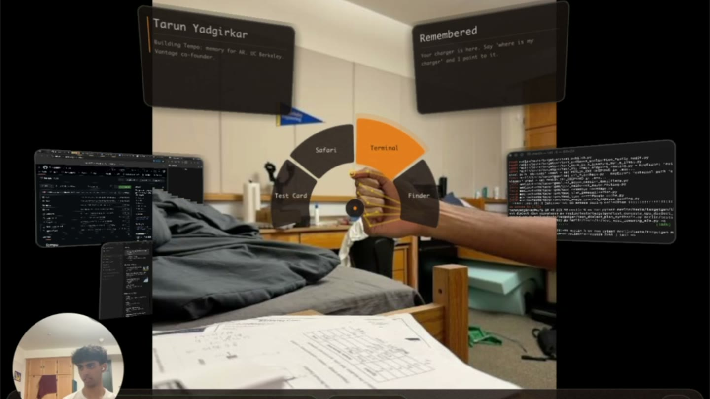
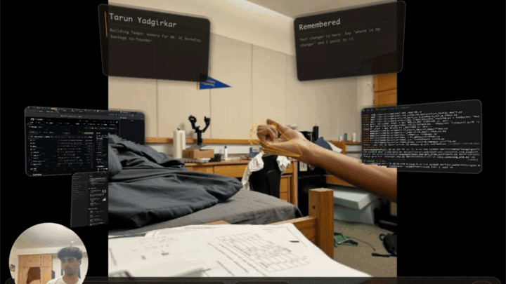

# Tempo

Tempo is an AR room agent. An iPhone strapped in front of a Mac streams head pose, LiDAR depth and hand skeletons; the Mac draws app windows and notes into the room, and an agent places them on the real wall or desk when you ask.

[](https://youtu.be/_lzXbNahwd8)

**[Watch the 95-second demo on YouTube](https://youtu.be/_lzXbNahwd8)**



In the clip, the wearer makes a fist to open the launcher and steers it by moving the hand. The radial launcher comes from the brought-in compositor; its app entries were added during the hackathon. The two notes on the wall were placed by the agent: a name card and a remembered place marking where the charger lives ("where is my charger" points back to it).

Built solo by Tarun Yadgirkar (UC Berkeley) at the East v. West 72 Hour Hackathon, Sep 12 to 14 2026, Deep Tech / Physical AI track. The compositor in `shell/` was brought in from earlier work, not written during the 72 hours; see [Prior work](#prior-work).

Judge check-in scores:

| Check-in | Innovation | Technical | Business | Presentation |
|---|---|---|---|---|
| 1 | 8 | 4 | 6 | 8 |
| 2 | 7 | 6 | 7 | 7 |

## The question

Spatial computers today are a phone-style app grid floating in front of your face. The room is scenery. Tempo asks what changes when the room itself is the interface: when an agent sees what you see, knows where the table, the walls, and your open windows are, and can put information *into the room* instead of talking at you.

The precise version: **how much does explicit room geometry buy an embodied agent over pixels alone, for the physical operation of placing information at a location?**

- **Operation.** Given a spoken request and the wearer's view, put a panel at the right physical spot (the desk, the wall behind the monitor, next to the thing being pointed at).
- **Baseline.** The same model, same prompt, same tools, but with the image only. It has to guess distances and surfaces from pixels.
- **Treatment.** Image plus the scene graph the compositor already has: head pose, LiDAR planes classified as table / wall / floor with distances, existing panels, and (from checkpoint 2) the hand pointing ray.
- **Measured.** On a fixed set of 20 requests in one room: placement error in metres from the intended surface (ground truth from the detected planes), surface-class accuracy (landed on a table when asked for the table), end-to-end latency from request to panel visible, and cost per request. Reported per checkpoint as the set grows.
- **Failure case we expect.** Requests that reference an object the planes don't describe ("next to the lamp"). Geometry gives no surface; the agent has to fall back to the image. We will report how often that fallback lands.

## What it is

An AR shell for glasses, running today on an iPhone strapped in front of a Mac.

- **iPhone** streams ARKit head pose, LiDAR depth, detected planes, camera frames, and 21-joint hand skeletons over UDP.
- **Mac compositor** (`shell/`, brought in from Vantage, not hackathon work) renders passthrough plus real Mac app windows as panels in 3D, with pinch-to-click, a spatial keyboard, and plane anchoring. Everything is driven through a line-protocol control socket.
- **Room agent** (`agent/`) is new this weekend. It takes a snapshot of what the wearer sees, the scene geometry (head pose, surfaces classified as table / wall / floor with distances, existing panels), and a spoken or typed request, sends them to Gemini (`gemini-3.8-flash`, set once in `agent/src/tempo/models.py`, override with `TEMPO_MODEL`) with a small set of spatial tools, and executes the returned actions against the compositor: place a note near the thing you pointed at, open an app where you're looking, move a panel onto the table, gather lost windows.

The agent never gets pixels-only or geometry-only. It gets both, which is what lets it answer "put that on the wall behind the monitor" with a world coordinate.

### What the agent knows about the room

| Signal | Where it comes from | What it enables |
|---|---|---|
| Head pose, gravity up, camera roll | ARKit on the phone | "in front", "left", "above", level panels |
| Surface under the gaze or the pointing finger | Ray march through the LiDAR depth map (`cast`) | notes that sit on the wall or lie on the desk with the surface's orientation |
| Floor height | Lowest horizontal depth cluster (`floor`) | "on the floor", height-aware placement |
| Objects with 3D positions | OWL-ViT open-vocabulary detector on the Mac GPU, box centre unprojected through LiDAR depth, tracked across frames, persisted (`agent/src/tempo/objects.py`) | "next to the whiteboard", "by the lamp" |
| Remembered places | Named 3D spots saved by the wearer (`memory.py`) | "remember this is my charger" / "where's my charger" answered relative to where they stand now |
| Hands | Mac-side RTMPose (rtmlib, ONNX) over the streamed frames, fused with LiDAR depth, injected into the compositor's gesture engine (`hands/`) | pinch to click, pinch-and-talk, "put it there" while pointing |
| Panels already in the room | compositor (`list-windows`) | move, close, gather, save and restore layouts |

### Talking to it

`uv run tempo live` is the daily driver: hold a pinch, speak, release. Speech goes through a local Whisper (mlx-whisper on the Mac GPU), the request plus the room snapshot goes to Gemini with the spatial tools, and the reply is spoken back. `tempo ask` is the typed equivalent.

## Architecture

```
iPhone (SpatialBridge)  --UDP 9898-->  mac-shell (Metal, ScreenCaptureKit)
                                           |  control socket ($TMPDIR/spatial-os.sock)
                                           |  screenshot · head-pose · list-planes · list-windows
                                           |  launch · launch-app · move · anchor · note · aim · layout
                                           v
                                     agent (Python)  <--tools-->  Gemini
```

## Setup

Compositor (macOS, Apple silicon, Xcode CLT, cmake + ninja):

```bash
cd shell
./scripts/build-mac.sh
./scripts/test-mac.sh
./scripts/run-mac.sh          # installs /Applications/Spatula.app and launches it
```

Grant Screen Recording once. Open SpatialBridge on the iPhone; it finds the Mac over Bonjour.

Agent:

```bash
cd agent
uv sync
echo 'GEMINI_API_KEY=...' > .env
uv run tempo scene                          # what the agent sees right now
uv run tempo ask put a note on the desk that says buy milk
uv run tempo --speak listen                 # push-to-talk loop
uv run tempo people --frames "$TMPDIR/spatula-frames"   # faces + voices, a bubble beside each head
uv run tempo people me Tarun                # 6 s of your own voice so your speech is never filed under a guest
cd ../hands && uv run hands calibrate --write   # open / pinch / fist, 6 s each; restart the shell to load the thresholds
```

Without a phone: `SPATULA_MAC_HEADLESS=1 shell/build/mac-shell/mac-shell --replay shell/tests/recorded-sessions/initial.bin` replays a recorded session so `head-pose` and `list-planes` work (screenshot needs the windowed renderer).

## Tests

```bash
cd agent && uv run pytest          # 22 tests: tool calls, placement eval scoring, people store
cd hands && uv run pytest          # 90 tests: keypoints, geometry, calibration, tracker
cd shell && ./scripts/test-mac.sh  # 31 ctest entries across gesture-engine, bridge-receiver, mac-shell
```

Two compositor entries depend on the machine. `screenshot_e2e` needs a display that is presenting frames and skips otherwise. The three `eval_dataset_*_smoke` entries run the gesture engine over the labelled iPhone clips in `~/spatial-os-recordings`, skip when that folder is absent, and report the detection score without failing on it (27 of 54 keyed clips on the last run). Run `shell/scripts/eval_dataset.py` without `--smoke` to gate on the score.

## Prior work

`shell/` was brought in, not built during the 72 hours. It is the compositor from Vantage (Project Ithaca), a private AR glasses startup Tarun co-founded with Boris Nezlobin: the Metal renderer, scene core and control socket, the iPhone sensor bridge, the gesture engine, and their tests. `shell/PRIOR_ART.md` lists exactly what was copied.

Built during the hackathon: everything in `agent/` and `hands/`, this README, and every compositor change listed in `shell/HACK_CHANGES.md` (new control verbs such as `cast`, `note` and `close-all`, note panels, spawn placement, the launcher's app entries).

## Checkpoint log

| # | When (PT) | State | What changed | Where feedback helps |
|---|---|---|---|---|
| 1 | Sat Sep 12, midnight | Live end to end: spoken or typed request → Gemini → note or app panel placed on the real surface, 3 to 4 s per request. Objects, remembered places, layouts, pinch-and-talk, Mac-side hand tracking all running on the rig. Two eval runs below. | Compositor base ported (31 shell tests). New today: the agent and its tools, note panels, depth ray-cast + full pose placement, floor and roll, OWL-ViT object map with LiDAR depth, spatial memory, layouts, local Whisper pinch-and-talk, RTMPose hands fused with LiDAR (77 tests), the placement eval, the hand-tracking eval. | Hand tracking: the Mac path matches the phone on detection but not yet on jitter; is the LiDAR-anchored shape model the right next step, or should we push frames to a cloud GPU running a mesh model (WiLoR) and eat the round trip? |
| 2 | Sun Sep 13, noon | Fist opens the launcher, pinch clicks; launched windows now land in a free slot in front of the wearer, take focus, and re-launching recalls instead of duplicating. Phantom hands past arm's reach are gated out of the Mac tracker. People layer: faces and voices in the room, a bubble beside each head with name and what they last said, names taken from speech. | `hands` range/confidence gate; shell spawn placement with depth pull-in, focus on spawn, `recall_panel`; `tempo people` (YuNet + ArcFace, mlx-whisper + ECAPA, siyi lookup), people in the scene JSON. | Is a bubble beside the head the right surface for people context, or should it live in the wearer's periphery until asked? What context is fair to show next to a face? |
| 3 | Sun Sep 13, 11:30 PM | Live people flow completed: speech gate, stable identity across nearby detections, bubble recovery, Gemini one-line summaries. Real app entries in the launcher (Safari, Terminal, Finder, Notes) and a close-all verb. Hardware bring-up: camera mounted on the glasses, display path, Raspberry Pi Pico controller. | `tempo people` live path, `voices.py` speech gate, `close-all`, launcher app entries. | Should the bubble show a summary automatically or stay name-only until asked? Does camera + display + Pico make the standalone direction clear? |
| 4 | Mon Sep 14, night | People layer on the live rig: face detected, named, persistent across sessions. 32 duplicate identities for one face found (ArcFace cross-frame similarity 0.30 to 0.57 vs 0.42 threshold) and merged. Real Safari and Notes panels placed in the room; name note on the wall. Hands 13 to 16 fps, 9 to 24 ms e2e. Eval set at 30 requests with object-anchored scoring (not yet run). Vertex opt-in path and WiLoR batch runner on the sponsored project (not run). Gestures still on defaults. | Identity merge in the people store, straight-quote bubble text, `eval.py` anchor scoring, `brain.py` Vertex path, `hands/wilor_batch.py`. | Per-session face clustering or adaptive threshold? One uncut final take or clips? |

### Checkpoint 1 result, and why the geometry condition lost

| Condition | Surface accuracy | Median off-surface error | Mean latency |
|---|---|---|---|
| Image + geometry | 0.25 | 0.55 m | 3.7 s |
| Image only (model guesses metre offsets) | 0.45 | 0.36 m | 4.4 s |

Twenty requests each, one room, same model and prompt (`gemini-3.6-flash`, the model the agent used during the hackathon). The geometry condition lost, and the identical 0.55 m error on every "desk" request says why: the LiDAR *plane list* the compositor exposes is sparse and stale. At run time it held eight vertical planes and a ceiling; the bed the wearer was looking at had been classified vertical and the desk was absent, so the gaze ray hit no horizontal surface and the executor fell back to a fixed offset ahead of the head. The image-only model, guessing "about 0.7 m ahead and 0.3 m down", landed closer.

So the baseline is doing its job: it shows that geometry only helps when the geometry is actually there.

**Second run, same evening, after replacing the plane list with a ray march through the dense LiDAR depth map** (`cast` verb, plus a full `pose` so panels take the surface's orientation):

| Condition | Surface accuracy | Median off-surface error | Wall requests only, median error | Mean latency |
|---|---|---|---|---|
| Image + depth geometry | 0.65 | 0.29 m | **0.05 m** (the 5 cm lift, i.e. on the wall) | 3.9 s |
| Image only | 0.65 | 0.39 m | 0.32 m | 4.8 s |

Every wall request now lands on the wall to within the deliberate 5 cm standoff. The remaining misses are all "desk" requests made while no horizontal surface was in the camera's view (the wearer was facing a wall and a bed), so both conditions put the note on the nearest wall; the scorer counts that as wrong for both. That's the honest limit of the setup, not of the method: the agent can only place on what the sensor sees. Next: the object detector so "next to the lamp" resolves, and a run with the desk in view.
